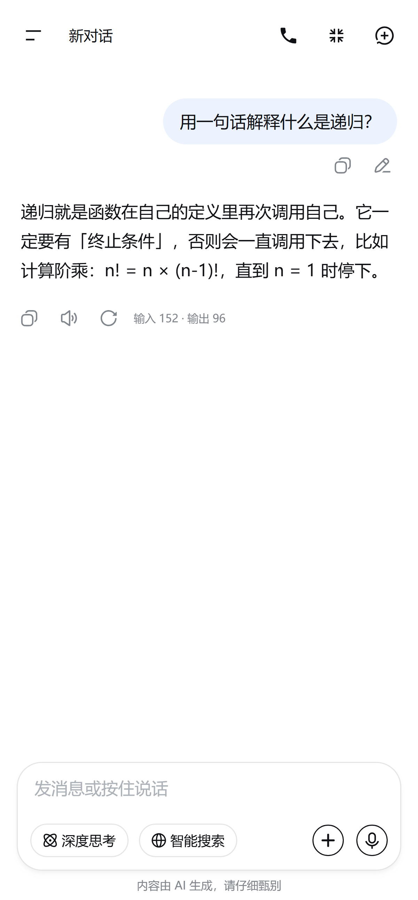
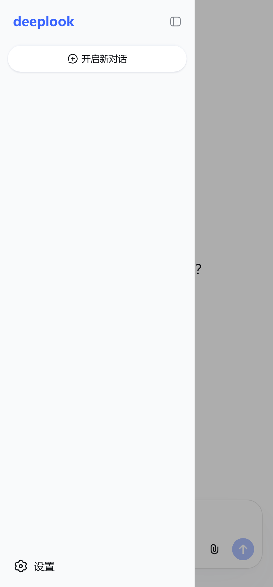
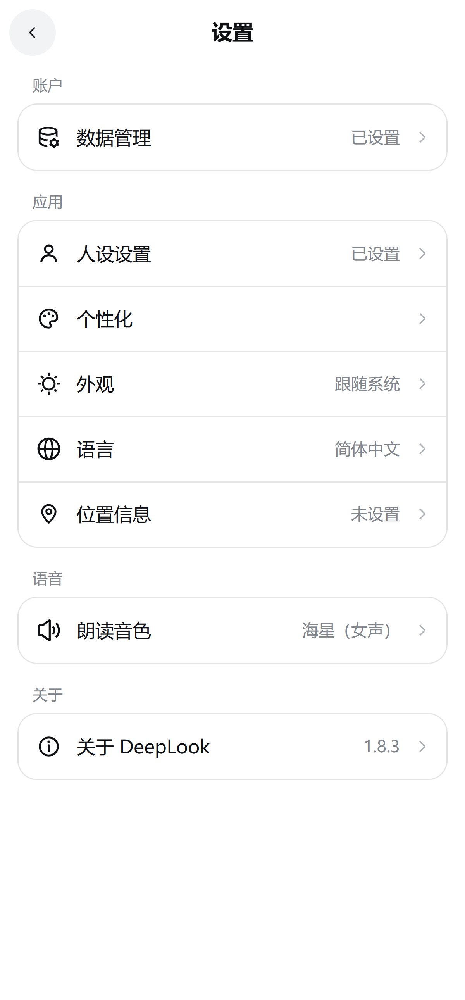
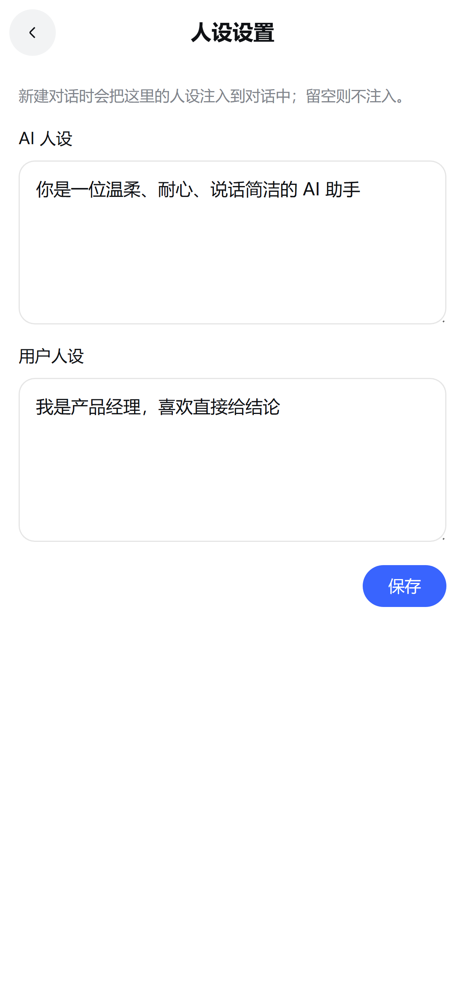
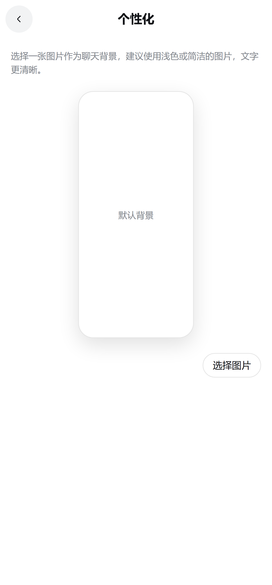
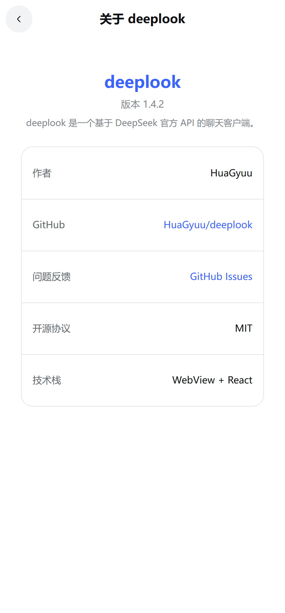

<p align="center">
  
</p>

<h1 align="center">DeepLook</h1>

<p align="center">基于 DeepSeek 官方 API 的安卓聊天客户端：WebView 套壳 + React/TypeScript 网页层 + 原生能力补齐</p>

<p align="center">
  <a href="https://github.com/HuaGyuu/deeplook/releases"></a>
  <a href="LICENSE"></a>
  
  
</p>

界面参考 DeepSeek 官方 chat-demo，并针对手机做了一整套适配与定制：

- 固定使用 DeepSeek 官方 API 与 `deepseek-flash` 模型，只需填 API Key；
- **语音输入**：输入框「按住说话」，松手转文字直接发出，上滑取消；
- **语音通话**：顶栏电话按钮进入通话页，按住说话 → 转写发送 → 回复按句朗读，按住时暂停朗读；
- **附件**：加号展开拍照 / 相册 / 文件，拍照直连系统相机；
- **多套 AI 人设**：名称 + 内容 + 可选相册封面，新建对话时用悬浮按钮选一个注入系统提示；
- 上下文压缩：顶栏按钮 + 80%/90%/100% 提示，用摘要开启新对话；
- 全局搜索：按关键词搜索所有对话标题与内容，多命中跳转高亮；
- 会话置顶、多选批量删除 / 批量置顶；
- 聊天背景：手机比例裁剪、单指拖动、双指缩放、发白程度调节；
- 余额卡片：侧边栏显示账户余额，一键前往充值；
- 每条回复显示本轮 token 用量（输入/输出），可展开查看缓存命中明细；
- 数据管理：导入导出历史对话，支持**粘贴下载链接自动下载并导入**（显示下载 / 导入进度，完成后清理临时文件）；
- 应用内检查更新：关于页请求 GitHub 最新 Release，直接下载安装 APK；
- 深色模式、跟随系统主题、中英文切换、历史对话导入导出、朗读回复。

> 本项目只做客户端，不代理也不存储你的聊天内容；API Key 与全部数据只保存在本机。

## 截图

| 聊天 | 侧边栏 | 设置 |
| --- | --- | --- |
|  |  |  |

| 人设 | 个性化 | 关于 |
| --- | --- | --- |
|  |  |  |

## 下载安装

前往 [Releases](https://github.com/HuaGyuu/deeplook/releases) 下载最新的 `deeplook-x.y.z.apk`，
传到手机安装（需允许安装未知来源应用），首次打开后到「设置 → 数据管理」填入 DeepSeek API Key 即可使用。

- 包名：`com.huagyuu.deeplook`
- 最低系统：Android 8.0（API 26），目标 Android 16（API 36）
- Release APK 使用项目内 debug 签名，便于直接安装体验；上架应用商店请替换为正式签名。
- 每个 Release 另附 `deeplook-x.y.z-diag.apk` 调试包，启动时会显示加载进度与诊断信息，仅用于排查问题。

## 功能

- **聊天**：多会话、流式回复、深度思考、联网搜索、Markdown / 代码高亮 / KaTeX / Mermaid、消息分支与重新生成。
- **会话**：重命名、删除、置顶；侧边栏多选批量删除 / 批量置顶。
- **输入框**：自适应高度、加号附件面板（拍照 / 相册 / 文件）、按住说话、语音 / 发送按钮随内容切换。
- **语音**：录音转写、按住说话上滑取消、语音通话（按住说话 + 按句朗读）、朗读回复。
- **人设**：AI 人设 + 用户人设写进 system prompt，新对话自动生效。
- **个性化**：聊天背景图（手机比例取景框裁剪、单指拖动、双指缩放、发白程度滑杆）。
- **设置**：独立页面，分组二级菜单；账户、数据管理、人设、个性化、外观、语言、位置、朗读音色、关于。
- **手势**：聊天页右滑打开侧边栏（跟手 + 甩动判定），抽屉左滑关闭；Android 返回键优先关闭设置 / 抽屉，最后退到后台。
- **原生壳**：WebViewAssetLoader 安全加载、文件 / 相册 / 相机、导出 ZIP 下载、麦克风权限、键盘避让、外链跳转、应用内更新安装。

## 技术栈

- Android：Java、`androidx.appcompat`、`androidx.webkit`、`WebViewAssetLoader`、FileProvider
- 网页层：React 18、TypeScript、zustand、Rspack、CSS Modules
- 网页层基于 [deepseek-ai/deepseek-chat-demo](https://github.com/deepseek-ai/deepseek-chat-demo)（MIT）

## 构建

环境：JDK 21、Android SDK（platform `android-36`、build-tools `36.0.0`）、Node.js 20+、pnpm。

```powershell
# 1) 构建 APK（网页层已预构建在 app/src/main/assets/web）
powershell -ExecutionPolicy Bypass -File scripts/build-apk.ps1

# 2) 如果修改了网页层，重新打包静态站后再出 APK
powershell -ExecutionPolicy Bypass -File scripts/build-web.ps1
powershell -ExecutionPolicy Bypass -File scripts/build-apk.ps1

# 或者用 Android Studio 打开本仓库直接 Run
```

产物：`app/build/outputs/apk/debug/app-debug.apk`，脚本会同时复制到 `dist/`。

网页层校验：

```sh
cd webapp
pnpm install
pnpm typecheck
pnpm test:adapters
```

## 目录结构

```
deeplook/
├── app/                      Android 应用模块（Java）
│   └── src/main/
│       ├── java/com/huagyuu/deeplook/
│       │   ├── MainActivity.java    WebView 容器：文件/相册/相机、下载、权限、键盘避让、返回键、应用内更新
│       │   ├── AndroidBridge.java   导出 ZIP / 录音权限 / 更新下载的原生桥
│       │   └── ChatApplication.java
│       ├── assets/web/              预构建的静态站
│       └── res/                     主题、颜色、图标、备份与网络安全配置
├── webapp/                   网页层源码（React + TypeScript）
│   └── src/
│       ├── app/                     App 外壳、主题、显隐与手势（viewport.ts）
│       ├── components/
│       │   ├── chatInput/           输入框、按住说话、附件面板、频谱
│       │   ├── voiceCall/           语音通话浮层
│       │   ├── session/             会话视图、顶栏、压缩
│       │   ├── sider/               侧边栏、抽屉、余额卡片
│       │   └── settings/            设置页、人设、个性化、关于、更新检查
│       └── services/                设置、会话存储（IndexedDB）、API、语音、更新
├── scripts/                  build-web.ps1 / build-apk.ps1 / publish-release.cjs
├── gradle/, gradlew, gradlew.bat    Gradle Wrapper（8.14.3）
├── keystore/debug.keystore   项目内 debug 签名
├── docs/                     图标与截图
└── LICENSE                   MIT
```

## 说明

- 网络：`settings.gradle` 优先使用阿里云 Maven 镜像、Gradle Wrapper 使用腾讯云镜像；海外环境可改回官方源（文件内有注释）。
- 数据：API Key、人设、聊天背景与全部会话只存在本机 WebView 存储中；会话正文在 IndexedDB，设置项在 localStorage。
- 兼容性：网页层不使用 `dvh` 等较新的 CSS 单位，保证系统 WebView 较老的机型也能正常布局。
- 更新记录见 [CHANGELOG.md](CHANGELOG.md)。

## License

[MIT](LICENSE) © 2026 HuaGyuu

网页层来自 deepseek-ai/deepseek-chat-demo（MIT），其许可证见 `webapp/LICENSE` 与 `app/src/main/assets/web/LICENSE`，第三方说明见 [THIRD_PARTY_NOTICES.md](THIRD_PARTY_NOTICES.md)。
