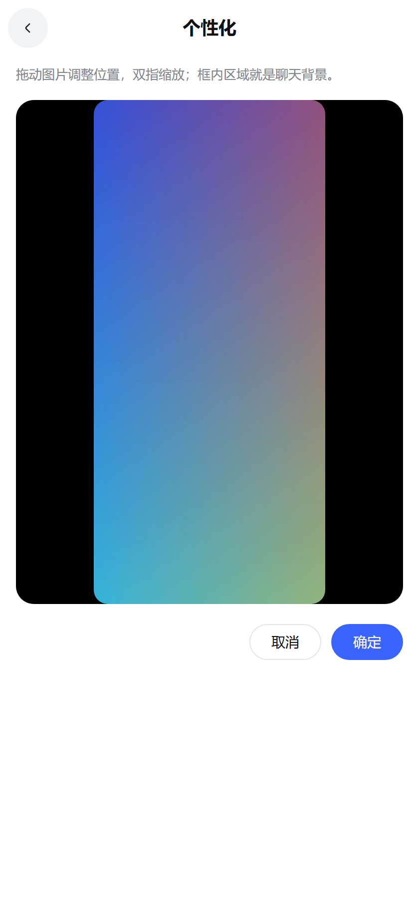

# deeplook

[](https://github.com/HuaGyuu/deeplook/releases)
[](LICENSE)
[](https://developer.android.com)

基于 DeepSeek 官方 API 的安卓聊天客户端：**WebView 套壳 + React/TypeScript 网页层 + 原生能力补齐**。
界面参考 DeepSeek 官方 chat-demo，并做了移动端适配与一系列定制：

- 固定使用 DeepSeek 官方 API 与 `deepseek-flash` 模型，只需填写 API Key；
- 人设设置（AI 人设 / 用户人设），每次对话自动注入；
- 会话置顶、图片上传、右滑打开侧边栏；
- 聊天背景图片：手机比例裁剪、拖动/双指缩放、发白程度调节；
- 独立设置页（分组 + 二级菜单），深浅色主题、中英文、历史导入导出、语音输入与朗读。

> 本项目只做客户端，不代理或存储你的聊天内容；API Key 与全部数据仅保存在本机。

## 截图

| 聊天 | 设置 | 背景裁剪 |
| --- | --- | --- |
|  |  |  |

| 个性化 | 人设 |
| --- | --- |
|  |  |

## 下载安装

前往 [Releases](https://github.com/HuaGyuu/deeplook/releases) 下载最新的 `deeplook-x.y.z.apk`，
传到手机安装（需允许安装未知来源应用），首次打开后到「设置 → 数据管理」填入 DeepSeek API Key 即可使用。

- 包名：`com.deepseek.chatdemo`
- 最低系统：Android 8.0（API 26），目标 Android 16（API 36）
- Release APK 使用项目内 debug 签名，便于直接安装体验；上架应用商店请替换为正式签名。

## 功能

- **聊天**：多会话、流式回复、深度思考、联网搜索、Markdown / 代码高亮 / KaTeX / Mermaid、消息分支与重新生成。
- **会话**：重命名、删除、置顶（「更多」菜单）。
- **附件**：文件、图片按钮（打开相册）、粘贴、拖拽上传。
- **语音**：录音转写、朗读回复。
- **人设**：AI 人设 + 用户人设写进 system prompt，新对话自动生效。
- **个性化**：聊天背景图（手机比例取景框裁剪、单指拖动、双指缩放、发白程度滑杆）。
- **设置**：独立页面，分组二级菜单；外观、语言、位置、朗读音色、数据管理、关于。
- **手势**：聊天页右滑打开侧边栏，抽屉左滑关闭；Android 返回键优先关闭设置/抽屉。
- **原生壳**：WebViewAssetLoader 安全加载、文件/相册选择、导出 ZIP 下载、麦克风权限、键盘避让、外链跳转。

## 技术栈

- Android：Java、`androidx.appcompat`、`androidx.webkit`、`WebViewAssetLoader`
- 网页层：React 18、TypeScript、zustand、Rspack、CSS Modules
- 网页层基于 [deepseek-ai/deepseek-chat-demo](https://github.com/deepseek-ai/deepseek-chat-demo)（MIT）

## 构建

环境：JDK 21、Android SDK（platform `android-36`、build-tools `36.0.0`）、Node.js 20+、pnpm。

```powershell
# 1) 构建 APK（网页层已预构建在 app/src/main/assets/web）
powershell -ExecutionPolicy Bypass -File scripts/build-apk.ps1

# 2) 如果修改了网页层，重新打包静态站后再出 APK
powershell -ExecutionPolicy Bypass -File scripts/build-web.ps1
powershell -ExecutionPolicy Bypass -File scripts/build-apk.ps1

# 或者用 Android Studio 打开本仓库直接 Run
```

产物：`app/build/outputs/apk/debug/app-debug.apk`，脚本会同时复制到 `dist/`。

网页层校验：

```sh
cd webapp
pnpm install
pnpm typecheck
pnpm test:adapters
```

## 目录结构

```
deeplook/
├── app/                     Android 应用模块（Java）
│   ├── src/main/java/com/deepseek/chatdemo/
│   │   ├── MainActivity.java      WebView 容器、文件/图片选择、下载、权限、键盘避让、返回键
│   │   ├── AndroidBridge.java     导出 ZIP 的原生桥
│   │   └── ChatApplication.java
│   ├── src/main/assets/web/       预构建的静态站
│   └── src/main/res/              主题、颜色、图标、备份与网络安全配置
├── webapp/                  网页层源码（React + TypeScript）
│   ├── src/
│   │   ├── components/settings/   独立设置页、人设、背景裁剪
│   │   ├── components/chatInput/  输入框（图片按钮）
│   │   ├── app/viewport.ts        移动端视口、右滑手势、整页滚动控制
│   │   └── services/              设置、人设、置顶、API 请求
│   ├── rspack.android.config.mjs
│   └── test/adapter.test.mjs
├── scripts/                 build-web.ps1 / build-apk.ps1
├── gradle/, gradlew, gradlew.bat   Gradle Wrapper（8.14.3）
├── keystore/debug.keystore  项目内 debug 签名
├── docs/screenshots/        截图
└── LICENSE                  MIT
```

## 说明

- 网络：`settings.gradle` 优先使用阿里云 Maven 镜像、Gradle Wrapper 使用腾讯云镜像；海外环境可改回官方源（文件内有注释）。
- 数据：API Key、人设、聊天背景与全部会话只存在本机 WebView 存储中。
- 更新记录见 [CHANGELOG.md](CHANGELOG.md)。

## License

[MIT](LICENSE) © 2026 HuaGyuu

网页层来自 deepseek-ai/deepseek-chat-demo（MIT），其许可证见 `webapp/LICENSE` 与 `app/src/main/assets/web/LICENSE`。